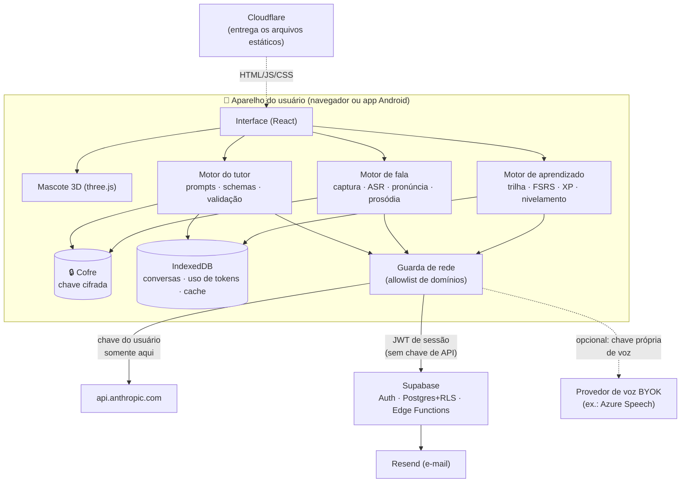
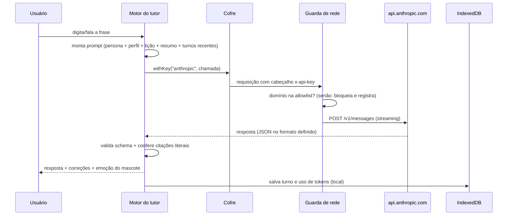

# Arquitetura — visão geral

## Princípios
1. **Local-first:** o aparelho faz o trabalho pesado (3D, fala, revisão espaçada, cálculos). O servidor só guarda progresso.
2. **BYOK com conhecimento zero:** o servidor do projeto **nunca** vê a chave de API. O aparelho fala direto com o provedor.
3. **Determinístico onde possível:** notas, níveis, agendamento de revisões, métricas de fala → código testável. A IA conversa, explica e gera conteúdo dentro de regras.
4. **Módulos com fronteiras:** cada parte tem uma porta de entrada; o lint impede atalhos. Isso permite trocar web ↔ nativo sem reescrever.
5. **Negar por padrão:** CSP, RLS e permissões começam fechados e abrem só o necessário.
6. **Plano gratuito como restrição de projeto:** toda escolha cabe nos planos gratuitos no início.

## Diagrama de componentes

## Fronteiras de confiança
| Zona | Quem controla | Vê a chave de API? | Vê conversas/áudio? | Vê progresso? |
|---|---|---|---|---|
| Aparelho do usuário | Usuário | Sim (cifrada em repouso) | Sim | Sim |
| Anthropic (API) | Anthropic, sob contrato **do usuário** | Recebe para autenticar | Recebe o texto das conversas | Só o que estiver no prompt |
| Provedor de voz BYOK (opcional) | Provedor, sob contrato do usuário | Recebe a chave **dele** | Recebe o áudio, se o usuário ativar | Não |
| Supabase (nosso backend) | Projeto PapeAI | **Nunca** | **Não** (só citações curtas de nivelamento e memória resumida) | Sim |
| Cloudflare (hospedagem) | Projeto PapeAI | Nunca | Não | Não |
| Resend (e-mail) | Projeto PapeAI | Nunca | Não | Só números do resumo semanal (opt-in) |

## O que o servidor do projeto nunca recebe
- A chave de API (nem cifrada, nem parcial, nem um hash dela).
- O conteúdo das conversas com o tutor.
- Áudios e gravações.
- O registro detalhado de uso de tokens/custos.
- Dados de localização, contatos, câmera.

## Fluxos principais

### 1. Turno de conversa com o tutor

### 2. Login (web)
1. Usuário toca "Entrar com Google" → redirecionamento OAuth com PKCE para o Google via Supabase Auth.
2. Volta para `app.<domínio>/auth/callback` (URL exata na allowlist do Supabase).
3. Supabase emite JWT de acesso (curto) + refresh token (rotacionado).
4. Primeiro login: um gatilho no banco cria `profiles`; o app mostra termos e privacidade.

### 3. Sincronização de progresso
1. O app grava primeiro localmente (IndexedDB) e coloca a mudança numa fila.
2. Com rede, envia ao Supabase com o JWT do usuário; o RLS garante que só as linhas dele são afetadas.
3. Conflitos: "última escrita vence" por campo, exceto contadores (somados no servidor por função).

### 4. Resumo semanal por e-mail (opt-in)
1. `pg_cron` dispara a Edge Function `weekly-summary` no horário programado.
2. A função (com a chave secreta do servidor) lê só quem optou, agrega números da semana e chama o Resend.
3. Cada envio é registrado em `private.email_log` (idempotência: no máximo 1 por usuário por semana).

### 5. Exclusão de conta
1. Usuário confirma no app (ou pela página web de solicitação).
2. Edge Function `delete-account` valida o JWT e exclui o usuário no Auth → `on delete cascade` apaga todas as linhas dele.
3. O app apaga os dados locais (cofre, conversas, cache). E-mail de confirmação é enviado.

## Camadas do aplicativo
| Camada | Responsabilidade | Exemplos |
|---|---|---|
| `features/` | Telas e fluxos | onboarding, nivelamento, lição, revisão, configurações |
| `core/` | Regras do domínio, sem tela | tutor, aprendizado, fala, cofre, dados, rede |
| `platform/` | Diferenças web x nativo | armazenamento seguro, notificações, microfone |
| `ui/` | Design system | botões, cartões, tokens de cor |
| `mascot/` | Cena 3D | carregamento GLB, máquina de estados, animações |

Detalhes e regras de import: `estrutura-de-pastas-e-modulos.md`.

## PWA (instalação e atualização)
- **Manifest** gerado pelo `vite-plugin-pwa` a partir de `app/src/platform/web/pwa/pwa-config.ts` (nome, cores dos tokens, ícones 192/512 e 512 *maskable*).
- **Ícones:** a arte-mestre é `tooling/icons/mascot-face.svg`; `pnpm --filter ./app icons` gera `app/public/favicon.svg` e os PNG em `app/public/icons/` (sem dependências, só Node). Um teste falha se os PNG ficarem desatualizados em relação à arte-mestre.
- **Service worker** (Workbox `generateSW`): guarda no aparelho **só os arquivos estáticos do build** (js, css, html, fontes latinas, svg, png, manifest). Nada de cache em tempo de execução, nada de outra origem, nada de API. Navegações caem no `index.html` (SPA), exceto `/.well-known/*` e caminhos com extensão (ex.: `robots.txt`).
- **Atualização com aviso:** uma versão nova fica "esperando" até o usuário tocar em **Atualizar** no aviso (`features/app-update`); a página recarrega já na versão nova. "Agora não" adia até todas as abas serem fechadas.
- **CSP:** o registro é importado do código (`virtual:pwa-register`), sem `<script>` inline; funciona com `script-src 'self'` e `worker-src 'self'`.
