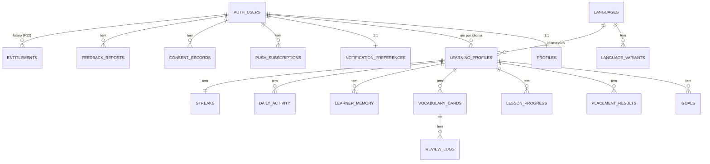

# Modelo de dados (servidor — Supabase/Postgres)

> **Status:** especificação planejada (v0). Ainda não há migração aplicada. A implementação acontece na F02 (núcleo) e é estendida nas fases seguintes. Toda mudança segue `evolucao-e-migracoes.md` e é registrada em `changelog-do-schema.md`.
>
> **Regra de ouro:** o servidor guarda **progresso de estudo**, não conversas, não áudio, **nunca** a chave de API. O que fica no aparelho está em `armazenamento-local.md`.

## Princípios do modelo
1. **Cada linha tem dono:** toda tabela de usuário tem `user_id uuid not null references auth.users(id) on delete cascade` — excluir o usuário apaga tudo dele.
2. **RLS em tudo que é exposto**, com políticas explícitas por operação (select/insert/update/delete).
3. **Grants explícitos** (tabela e coluna). Nada de privilégio padrão amplo.
4. **FK não respeita RLS:** usamos **FKs compostas** `(x_id, user_id)` para impedir que um usuário ligue sua linha à linha de outro.
5. **Validação no banco** (`check`) além da validação no app: tamanhos, formatos, faixas.
6. **IDs opacos** (`uuid`), nunca sequenciais nas tabelas expostas.
7. **Schema `private`** (não exposto pela API) para logs, filas e funções internas.
8. **Mínimo necessário:** se um dado não serve para o aprendizado ou para obrigação legal, não é guardado.

## Diagrama (entidades principais)


## Tipos (enums)
```sql
create type public.cefr_level    as enum ('pre_a1','a1','a2','b1','b2','c1','c2');
create type public.feedback_mode as enum ('gentle','balanced','blunt');
create type public.subtitle_mode as enum ('always','on_tap','off');
create type public.goal_kind     as enum ('work','travel','relocation','study','exam','culture','hobby','family','other');
create type public.consent_kind  as enum ('terms','privacy','age_18_plus','email_engagement','email_product_news','blunt_mode','cloud_voice_provider');
create type public.skill         as enum ('speaking','listening','reading','writing','vocabulary','grammar','pronunciation');
create type public.lesson_status as enum ('started','completed','abandoned');
```
> Adicionar valor a um enum é uma migração (`alter type ... add value`). Remover valor exige estratégia expand/contract (ver `evolucao-e-migracoes.md`).

## Tabelas de referência (somente leitura para usuários)
### `public.languages`
| Coluna | Tipo | Regras | Descrição |
|---|---|---|---|
| `code` | text PK | `^[a-z]{2,3}$` | ISO 639 (ex.: `en`) |
| `name_native` | text | 1–40 | "English" |
| `enabled` | boolean | default false | Idioma disponível no app |

### `public.language_variants`
| Coluna | Tipo | Regras | Descrição |
|---|---|---|---|
| `code` | text PK | BCP-47 (ex.: `en-AU`) | Variante/sotaque |
| `language_code` | text FK → `languages.code` | | |
| `enabled` | boolean | default false | |

Acesso: `grant select ... to authenticated`; sem insert/update/delete para usuários (só migrações).

## Tabelas de usuário

### `public.profiles` (1:1 com `auth.users`) — F02
| Coluna | Tipo | Regras | Descrição |
|---|---|---|---|
| `id` | uuid PK, FK → `auth.users(id)` on delete cascade | | Mesmo id do Auth |
| `display_name` | text null | 1–40 caracteres | Como o mascote chama a pessoa |
| `ui_locale` | text | `pt-BR` \| `en`, default `pt-BR` | Idioma da interface |
| `native_language` | text | ISO 639, default `pt` | Idioma das explicações |
| `timezone` | text | IANA, default `America/Sao_Paulo` | Lembretes e "dia" de estudo |
| `quality_profile` | text | `economy` \| `balanced` \| `max`, default definido na F04 | Perfil de modelo (ADR-0008) |
| `age_confirmed_at` | timestamptz null | | Autodeclaração 18+ |
| `onboarding_completed_at` | timestamptz null | | |
| `active_learning_profile_id` | uuid null | FK composta `(active_learning_profile_id, id)` → `learning_profiles(id, user_id)` | Idioma em estudo |
| `created_at` / `updated_at` | timestamptz | default `now()` / gatilho | |

Criação: gatilho `after insert on auth.users` chama `private.handle_new_user()` (security definer, `search_path = ''`), que cria `profiles` e `notification_preferences`.
Grants: `select` na tabela; `update` **só nas colunas** `display_name, ui_locale, native_language, timezone, quality_profile, age_confirmed_at, onboarding_completed_at, active_learning_profile_id`.

### `public.learning_profiles` (um por idioma-alvo) — F02/F05
| Coluna | Tipo | Regras | Descrição |
|---|---|---|---|
| `id` | uuid PK | `gen_random_uuid()` | |
| `user_id` | uuid FK → `auth.users` cascade | `unique (id, user_id)` para FKs compostas | |
| `target_language` | text FK → `languages.code` | | Ex.: `en` |
| `accent_variant` | text FK → `language_variants.code` | | Ex.: `en-AU` |
| `current_level` | cefr_level null | | Null até o nivelamento |
| `current_sublevel` | smallint null | 1–3 | Ex.: A2.**2** |
| `level_source` | text null | `placement` \| `progress` \| `reassessment` \| `self_reported` | |
| `level_updated_at` | timestamptz null | | |
| `daily_goal_minutes` | smallint | 5, 10, 15, 20, 30; default 10 | Meta diária |
| `feedback_mode` | feedback_mode | default `balanced` | `blunt` exige consentimento registrado |
| `subtitle_mode` | subtitle_mode | default `always` | |
| `speech_rate` | numeric(3,2) | 0,50–1,25; default 1,00 | Velocidade do TTS |
| `explanation_language` | text | `auto` \| `native` \| `target` | `auto` = imersão progressiva |
| `correction_timing` | text | `immediate` \| `end_of_activity` | |
| `correction_density` | text | `all` \| `main` \| `minimal` | |
| `created_at` / `updated_at` | timestamptz | | |

Restrição: `unique (user_id, target_language)`.

### `public.goals` — F05
| Coluna | Tipo | Regras | Descrição |
|---|---|---|---|
| `id` | uuid PK | | |
| `user_id` | uuid | FK composta com `learning_profile_id` | |
| `learning_profile_id` | uuid | FK composta → `learning_profiles(id, user_id)` cascade | |
| `kind` | goal_kind | | trabalho, viagem, mudança... |
| `title` | text | 1–80 | Nas palavras do usuário |
| `profession_code` | text null | `^[a-z0-9_]{2,40}$` | De lista controlada (ex.: `software_developer`) |
| `country_code` | text null | `^[A-Z]{2}$` | ISO 3166-1 (ex.: `AU`) |
| `region` | text null | ≤ 60 | Cidade/estado (ex.: Sydney) |
| `target_date` | date null | | Data da viagem/mudança |
| `interests` | text[] | ≤ 10 itens, tags controladas | |
| `notes` | text null | ≤ 280 | Livre (o app avisa: não coloque dados sensíveis) |
| `priority` | smallint | 1–5, default 3 | Peso no entrelaçamento |
| `is_active` | boolean | default true | |
| `created_at` / `updated_at` | timestamptz | | |

### `public.placement_results` — F05
| Coluna | Tipo | Regras | Descrição |
|---|---|---|---|
| `id`, `user_id`, `learning_profile_id` | | FK composta | |
| `started_at` / `completed_at` | timestamptz | | |
| `was_skipped` | boolean | | "Sou iniciante total" |
| `result_level` | cefr_level | | |
| `result_sublevel` | smallint | 1–3 | |
| `confidence` | numeric(3,2) | 0–1 | Probabilidade do nível escolhido |
| `skill_estimates` | jsonb | schema validado no app e por `check` de chaves | Ex.: `{"grammar":"a2","vocabulary":"b1",...}` |
| `evidence` | jsonb | ≤ 12 itens; cada citação ≤ 200 caracteres | Citações curtas das frases do aluno |
| `turns_count` | smallint | 0–20 | |
| `prompt_version` / `model` | text | | Rastreabilidade da IA |

**Imutável** depois de criado (sem `update`). A transcrição completa fica só no aparelho (NIV-09).

### `public.lesson_progress` — F06
| Coluna | Tipo | Regras | Descrição |
|---|---|---|---|
| `id`, `user_id`, `learning_profile_id` | | FK composta | |
| `lesson_key` | text | `^[a-z]{2}\.[a-z0-9_.]{3,80}$` | ID estável do conteúdo (ex.: `en.a2.u03.l02`) |
| `unit_key` | text | | |
| `status` | lesson_status | | |
| `score` | smallint null | 0–100 | Calculado em código |
| `xp_earned` | integer | 0–500 | |
| `duration_seconds` | integer | 0–7200 | |
| `skills` | skill[] | | Habilidades praticadas |
| `started_at` / `completed_at` | timestamptz | | |

Índice: `(user_id, learning_profile_id, lesson_key)`.

### `public.vocabulary_cards` (revisão espaçada FSRS) — F06
| Coluna | Tipo | Regras | Descrição |
|---|---|---|---|
| `id`, `user_id`, `learning_profile_id` | | FK composta | |
| `term` | text | 1–80 | Palavra/expressão |
| `term_normalized` | text | minúsculas, espaços normalizados | Para unicidade |
| `meaning` | text | ≤ 200 | No idioma nativo |
| `example` | text null | ≤ 300 | Frase de exemplo |
| `part_of_speech` | text null | lista controlada | |
| `cefr_tag` | cefr_level null | | |
| `source` | text | `lesson` \| `conversation` \| `manual` \| `placement` | |
| `theme_tags` | text[] | ≤ 10 | Ex.: `profession.software_developer` |
| `due` | timestamptz | | Próxima revisão (FSRS) |
| `stability` / `difficulty` | double precision | | Estado FSRS |
| `elapsed_days` / `scheduled_days` | integer | | |
| `reps` / `lapses` | integer | ≥ 0 | |
| `state` | smallint | 0 novo, 1 aprendendo, 2 revisão, 3 reaprendendo | |
| `last_review` | timestamptz null | | |
| `suspended` | boolean | default false | |
| `created_at` / `updated_at` | timestamptz | | |

Restrição: `unique (user_id, learning_profile_id, term_normalized)`. Índice: `(user_id, due) where not suspended`.

### `public.review_logs` — F06
`id`, `card_id` (FK cascade), `user_id`, `rating` (1–4: errei, difícil, bom, fácil), `state`, `due`, `stability`, `difficulty`, `elapsed_days`, `scheduled_days`, `reviewed_at`. Append-only (sem update/delete pelo usuário). Serve para otimizar os parâmetros do FSRS no futuro.

### `public.learner_memory` ("o que o tutor sabe sobre você") — F04
| Coluna | Tipo | Regras | Descrição |
|---|---|---|---|
| `id`, `user_id`, `learning_profile_id` | | FK composta | |
| `kind` | text | `recurring_error` \| `strength` \| `interest` \| `context` \| `preference` | |
| `content` | text | 1–200 | Ex.: "Confunde *since* e *for*" |
| `evidence_count` | integer | ≥ 1 | Quantas vezes foi observado |
| `last_seen_at` | timestamptz | | |
| `source` | text | `tutor` \| `user` | Quem criou |
| `created_at` / `updated_at` | timestamptz | | |

O usuário vê, edita e apaga tudo isso na tela "O que o tutor sabe sobre você" (TUT-07). Limite: 100 itens por perfil (os mais antigos com `evidence_count` baixo saem primeiro).

### `public.daily_activity` — F06
PK `(user_id, learning_profile_id, activity_date)`; colunas `minutes_practiced` (0–600), `xp` (0–5000), `lessons_completed` (0–50), `reviews_done` (0–2000), `goal_met` boolean. Escrita **somente** pela função `public.record_activity(...)`, que valida posse e limites e atualiza `streaks`.

### `public.streaks` — F06
PK `(user_id, learning_profile_id)`; `current_count`, `longest_count`, `last_goal_date` (date), `freezes_available` (0–2), `updated_at`. Somente leitura para o usuário; escrita pela função acima.

### `public.notification_preferences` (1:1) — F02/F09
| Coluna | Tipo | Default | Descrição |
|---|---|---|---|
| `user_id` | uuid PK | | |
| `daily_reminder_enabled` | boolean | true | Lembrete local no aparelho |
| `daily_reminder_local_time` | time | `19:00` | |
| `quiet_hours_start` / `quiet_hours_end` | time | `22:00` / `08:00` | |
| `email_weekly_summary` | boolean | **false** | Opt-in |
| `email_monthly_report` | boolean | **false** | Opt-in |
| `email_reengagement` | boolean | **false** | Opt-in |
| `email_travel_countdown` | boolean | **false** | Opt-in |
| `email_product_news` | boolean | **false** | Opt-in |
| `push_enabled` | boolean | false | |
| `updated_at` | timestamptz | | |

Mudanças em opções de e-mail também geram linha em `consent_records`.

### `public.push_subscriptions` — F09/F10
`id`, `user_id`, `platform` (`web`\|`android`\|`ios`), `endpoint` (text, ≤ 2048), `keys` (jsonb, p256dh/auth para web push), `created_at`, `last_used_at`. CRUD do próprio dono; a Edge Function de envio lê com a chave secreta.

### `public.consent_records` (append-only) — F02
`id` (bigint identity), `user_id`, `kind` (consent_kind), `document_version` (ex.: `privacy-2027-01`), `granted` (boolean), `recorded_at` (default `now()`), `platform` (`web`\|`android`\|`ios`). Usuário pode inserir e ler as próprias; **não** pode alterar nem apagar. Ver ressalva sobre exclusão de conta em `../seguranca/privacidade-lgpd.md`.

### `public.feedback_reports` — F04
`id`, `user_id`, `kind` (`bug`\|`wrong_correction`\|`idea`\|`other`), `message` (≤ 2000), `context` (jsonb: versão do app, tela, versão do prompt — **sem** transcrição, a menos que o usuário anexe explicitamente o trecho), `created_at`. Inserir e ler as próprias.

### `public.entitlements` — F12 (futuro)
`id`, `user_id`, `sku`, `source` (`play`\|`app_store`\|`promo`\|`sponsor`), `granted_at`, `expires_at`. Usuário só lê; escrita apenas por Edge Function após validar a compra na loja.

## Matriz de acesso (role `authenticated`)
| Tabela | select | insert | update | delete |
|---|---|---|---|---|
| `languages`, `language_variants` | todos | — | — | — |
| `profiles` | próprio | gatilho | próprio, colunas limitadas | via exclusão de conta |
| `learning_profiles` | próprio | próprio | próprio | próprio |
| `goals` | próprio | próprio | próprio | próprio |
| `placement_results` | próprio | próprio | — | próprio |
| `lesson_progress` | próprio | próprio | próprio | — |
| `vocabulary_cards` | próprio | próprio | próprio | próprio |
| `review_logs` | próprio | próprio | — | — |
| `learner_memory` | próprio | próprio | próprio | próprio |
| `daily_activity` | próprio | função | função | — |
| `streaks` | próprio | função | função | — |
| `notification_preferences` | próprio | gatilho | próprio | — |
| `push_subscriptions` | próprio | próprio | próprio | próprio |
| `consent_records` | próprio | próprio | — | — |
| `feedback_reports` | próprio | próprio | — | — |
| `entitlements` | próprio | servidor | servidor | servidor |

Role `anon` (não logado): **nenhum** acesso a nenhuma tabela.

## Padrões SQL (referência para as migrações)
```sql
-- 1) Tabela com dono + FK composta
create table public.goals (
  id uuid primary key default gen_random_uuid(),
  user_id uuid not null references auth.users(id) on delete cascade,
  learning_profile_id uuid not null,
  -- ... colunas ...
  foreign key (learning_profile_id, user_id)
    references public.learning_profiles (id, user_id) on delete cascade
);
create index goals_user_id_idx on public.goals (user_id);

-- 2) RLS + grants explícitos
alter table public.goals enable row level security;
revoke all on public.goals from anon, authenticated;
grant select, insert, update, delete on public.goals to authenticated;

-- 3) Políticas por operação ((select auth.uid()) é avaliado uma vez por consulta)
create policy goals_select_own on public.goals
  for select to authenticated using ((select auth.uid()) = user_id);
create policy goals_insert_own on public.goals
  for insert to authenticated with check ((select auth.uid()) = user_id);
create policy goals_update_own on public.goals
  for update to authenticated
  using ((select auth.uid()) = user_id) with check ((select auth.uid()) = user_id);
create policy goals_delete_own on public.goals
  for delete to authenticated using ((select auth.uid()) = user_id);

-- 4) updated_at automático
create trigger goals_set_updated_at before update on public.goals
  for each row execute function private.set_updated_at();

-- 5) Função privilegiada exposta como RPC: checa o chamador, limita valores, search_path vazio
create function public.record_activity(
  p_learning_profile_id uuid, p_local_date date,
  p_minutes int, p_xp int, p_lessons int, p_reviews int
) returns void
language plpgsql security definer set search_path = '' as $$
begin
  if not exists (
    select 1 from public.learning_profiles lp
    where lp.id = p_learning_profile_id and lp.user_id = (select auth.uid())
  ) then
    raise exception 'forbidden' using errcode = '42501';
  end if;
  -- clamp dos valores, upsert em daily_activity, recálculo de streaks ...
end; $$;
revoke execute on function public.record_activity(uuid, date, int, int, int, int) from public, anon;
grant execute on function public.record_activity(uuid, date, int, int, int, int) to authenticated;
```

## Schema `private` (não exposto pela API)
| Objeto | Uso | Retenção |
|---|---|---|
| `private.handle_new_user()` | Gatilho de criação de perfil | — |
| `private.set_updated_at()` | Gatilho genérico | — |
| `private.email_log` | `id, user_id, template, sent_at, provider_message_id, status` — idempotência e auditoria de envios | 90 dias |
| `private.job_runs` | Execuções do `pg_cron` | 30 dias |
| `private.rate_limits` | Contadores por usuário/ação para Edge Functions (ex.: exportação 3x/dia) | 7 dias |
| `private.deletion_events` | Data da exclusão + motivo opcional, **sem** e-mail nem id reversível | 24 meses |

## Retenção (resumo — política completa em `../seguranca/privacidade-lgpd.md`)
| Dado | Retenção |
|---|---|
| Conta e progresso | Até a exclusão (ou 24 meses de inatividade, se Q-22 aprovada) |
| `review_logs` | 24 meses (depois agregamos) |
| `feedback_reports` | 12 meses |
| `private.email_log` | 90 dias |

## Dados de desenvolvimento
- `supabase/seed.sql` contém **somente dados fictícios** (usuários `teste-a@exemplo.invalid`, `teste-b@exemplo.invalid`).
- Nunca copiar dados reais de produção para desenvolvimento.

## Verificações obrigatórias antes de cada portão que mexe no banco
- [ ] Toda tabela de `public` com RLS ativo e políticas para as 4 operações (ou ausência intencional documentada).
- [ ] Teste de RLS com dois usuários: A não lê/edita/apaga nada de B (todas as tabelas).
- [ ] `anon` não lê nenhuma tabela.
- [ ] Security Advisor do Supabase sem erros.
- [ ] Este documento e o `changelog-do-schema.md` atualizados.
