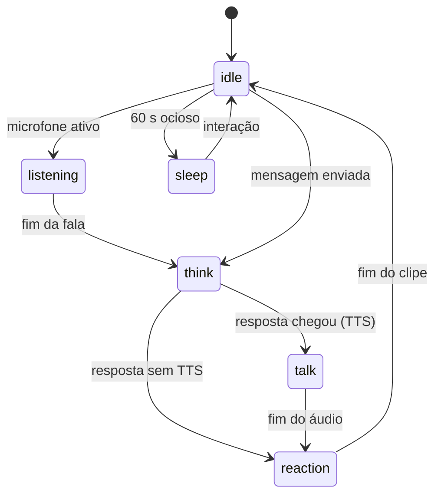

# Mascote 3D — especificação

> Requisitos MAS-01 a MAS-08. O mascote é **renderizado no aparelho**: não consome tokens. A IA só manda um campo curto (`mascot_emotion`) que escolhe a animação.

## Decisão (Q-02, 2026-11-26): **macaco-sagui** ✅
| Aspecto | Notas |
|---|---|
| Por que combina | Fauna brasileira, pequeno e "fofo", rosto muito expressivo; é primata, então tem **mãos**: `thumbs_up`, `facepalm`, `wave_hello` e gestos saem naturais, sem pose forçada |
| Traços marcantes para a silhueta | Tufos brancos nas orelhas (sagui-de-tufos-brancos), mancha clara na testa, cauda longa listrada |
| Cuidados de modelagem | Tufos e cauda consomem triângulos e ossos: usar cartões/formas simples e ≤ 4 ossos na cauda para caber no orçamento abaixo |
| Cuidados de marca | Não lembrar macacos de mascotes conhecidos (jogos, desenhos); paleta e tufos devem ser a assinatura própria |
| Cuidado de mensagem | Nunca sugerir o sagui como animal de estimação (posse de animal silvestre exige autorização no Brasil) |

## Candidatos avaliados
| Animal | Por que combina | Cuidados |
|---|---|---|
| **Papagaio** | Fala e imita sons (repetir, *shadowing*); fauna brasileira; asas gesticulam; talvez combine com "Pape" | "Papagaiar" = repetir sem entender → virar piada a favor ("aqui o papagaio entende!"); não lembrar a coruja verde |
| **Capivara** | Querida, calma, viral; contraste hilário com o modo sem filtro | Quadrúpede: gestos exigem pose antropomórfica (em pé) |
| **Lobo-guará** | Ícone brasileiro, elegante, original | Pernas longas complicam enquadramento |
| **Bicho-preguiça** | Piada pronta com "falar mais devagar" | Pode passar ideia de lentidão no aprendizado |
| **Tamanduá** | Diferente, simpático | Focinho longo complica sincronia labial |

## Estilo
- **Low poly com bordas suaves:** silhueta simples e "fofa" (cabeça grande, ~45% da altura), poucos polígonos, mas **sombreamento suave** (normais suavizadas) e **chanfros** nas arestas visíveis — nada de facetas pontudas no rosto.
- **Textura única 128×128 px** em **atlas de paleta**: cada área do modelo é mapeada para um bloco de cor da textura (troca de paleta = troca de "roupa" barata).
- **Rosto expressivo:** olhos e boca por *morph targets* (formas) **ou** por quadros numa segunda textura 128×128 (troca de UV) — escolher no protótipo.
- Material simples (toon ou Lambert/Standard com pouca rugosidade); luz principal + luz ambiente; sombra falsa (disco suave no chão).

## Orçamento de performance (MAS-05)
| Item | Limite |
|---|---|
| Triângulos | ≤ 3.000 (alvo 1.500–2.500) |
| Materiais / draw calls | 1–2 |
| Texturas | 1–2 × 128×128 |
| Ossos | ≤ 30 |
| Clipes de animação | ≤ 14 |
| Arquivo `.glb` final (compactado) | ≤ 400 KB |
| FPS | 60 em celular intermediário; nunca < 30 |
| Quando a aba está oculta | Renderização pausada |
| Pixel ratio | Limitado a 2 |

## Animações (MAS-03)
| Clipe | Duração | Loop | Quando |
|---|---|---|---|
| `idle` | 3–4 s | Sim | Padrão (respiração + piscar aleatório) |
| `listening` | 2 s | Sim | Microfone ativo (inclina a cabeça) |
| `think` | 2 s | Sim | Esperando a resposta da IA |
| `talk` | — | Sim | Enquanto o TTS toca (boca dirigida pelo áudio) |
| `happy_bounce` | 1 s | Não | Acerto |
| `celebrate` | 2 s | Não | Marco, subir de nível |
| `thumbs_up` | 1 s | Não | Incentivo |
| `surprised` | 1 s | Não | Frase muito boa |
| `proud_nod` | 1,5 s | Não | Fim de lição |
| `facepalm` | 1,5 s | Não | Só no modo sem filtro |
| `eye_roll` | 1 s | Não | Só no modo sem filtro |
| `wave_hello` / `wave_bye` | 1,5 s | Não | Entrada/saída |
| `sleep` | 4 s | Sim | App ocioso (nunca usado para culpar o aluno) |

## Máquina de estados

`reaction` = clipe escolhido por `mascot_emotion` (mapa em `../ia/personalidade-e-modos-de-feedback.md`). Transições com *crossfade* de 0,2–0,3 s.

## Sincronia labial (MAS-04)
- **Nível 1 (padrão):** abertura da boca proporcional à amplitude do áudio do TTS (barato, funciona com qualquer voz).
- **Nível 2 (se o provedor de TTS fornecer visemes):** 6–8 formas de boca (repouso, A, E, I, O, U, M/B/P, F/V).

## Acessibilidade e reserva (MAS-07)
- O mascote é **decorativo**: toda informação também está em texto.
- `prefers-reduced-motion` → só `idle` mínimo e reações estáticas.
- Opção "ocultar mascote" (economiza bateria).
- Aparelho sem WebGL ou fraco → imagem 2D (sprites das expressões).

## Pipeline de produção (trilha de arte, pode começar após a F00)
1. **Conceito:** 3–5 esboços (pode ser rascunho com IA de imagem — atenção à licença de uso) → dono escolhe.
2. **Folha de modelo:** frente/lado/costas, proporções, paleta.
3. **Bloqueio** no Blender (gratuito) → **refino** low poly → chanfros e suavização.
4. **UV + atlas de paleta 128×128.**
5. **Rig** (≤ 30 ossos) + formas do rosto.
6. **Animações** (lista acima).
7. **Exportação glTF 2.0 binário (`.glb`)** com compressão de malha (meshopt ou Draco — testar compatibilidade).
8. **Teste no app** (F08): FPS, tamanho, aparência em tela pequena.
> No ambiente do dono há um servidor MCP do Blender disponível: a IA pode ajudar a criar/ajustar o modelo **dentro do Blender**, sempre com aprovação a cada etapa.

## Convenções de arquivos
```text
art/mascot/
├─ concept/            # esboços e folha de modelo
├─ source/mascot.blend # arquivo-fonte (considerar Git LFS)
├─ textures/palette_128.png, face_128.png
└─ export/mascot.glb   # copiado para app/public/models/
```
Nomes de clipes exatamente como na tabela (o código depende deles).

## Direitos (MAS-08)
- Arte e marca com licença **separada** do código (ADR-0005): ninguém pode reutilizar o mascote em outro app sem permissão.
- Se houver contribuição de artistas, registrar a cessão de direitos.
- Assets de terceiros só com licença compatível e registrada.

## Critérios de aceite (portão F08)
- [ ] Orçamento respeitado (medido e registrado).
- [ ] 60 FPS no celular do dono (ou ≥ 30 justificado).
- [ ] Todas as animações da tabela presentes e nomeadas corretamente.
- [ ] Reações corretas para cada `mascot_emotion`.
- [ ] Sincronia labial nível 1 funcionando com o TTS.
- [ ] Movimento reduzido, ocultar mascote e reserva 2D funcionando.
- [ ] Dono aprovou a aparência ("é fofo e é a nossa cara").
