# Fases de desenvolvimento — mapa geral

Cada fase é uma "grande etapa" com **objetivo, escopo, passos, verificações e um portão de aprovação**. A IA só começa a fase seguinte depois que o dono diz **"aprovado F0X"**.

## Sequência e marcos

```mermaid
flowchart LR
  F00[F00 Fundação<br/>e decisões] --> F01[F01 Esqueleto web<br/>+ segurança base]
  F01 --> F02[F02 Contas<br/>e usuários]
  F02 --> F03[F03 Cofre BYOK<br/>+ cliente Claude]
  F03 --> F04[F04 Tutor<br/>em texto]
  F04 --> M1((M1<br/>Eu uso))
  M1 --> F05[F05 Onboarding<br/>+ nivelamento]
  F05 --> F06[F06 Trilha<br/>de aprendizado]
  F06 --> F07[F07 Voz]
  F07 --> F08[F08 Mascote 3D]
  F08 --> F09[F09 Engajamento<br/>notificações/e-mails]
  F09 --> M2((M2<br/>Beta web))
  M2 --> F10[F10 App Android]
  F10 --> M3((M3<br/>Android))
  M3 --> F11[F11 Endurecimento<br/>+ lançamento]
  F11 --> M4((M4<br/>Público))
  M4 --> F12[F12 Evolução]
  A[[Trilha paralela de ARTE<br/>conceito → modelo → animações]] -.alimenta.-> F08
  C[[Trilha paralela de CONTEÚDO<br/>currículo, temas, notas culturais]] -.alimenta.-> F06
```

| Fase | Nome | Entrega principal | Marco |
|---|---|---|---|
| [F00](F00-fundacao-e-decisoes.md) | Fundação e decisões | Decisões aprovadas, contas seguras, ambiente pronto | — |
| [F01](F01-esqueleto-web-e-seguranca-base.md) | Esqueleto web, design system e segurança base | App vazio online, CSP, robots, CI | — |
| [F02](F02-contas-e-usuarios.md) | Contas, usuários e dados no servidor | Login Google/e-mail, perfis, RLS testado, excluir/exportar | — |
| [F03](F03-cofre-byok-e-cliente-claude.md) | Cofre da chave (BYOK) e conexão com o Claude | Chave cifrada no aparelho, chat simples, painel de custo | — |
| [F04](F04-tutor-em-texto.md) | Tutor em texto | Conversa com correções verificadas, modos de feedback, memória | **M1 "Eu uso"** |
| [F05](F05-onboarding-objetivos-e-nivelamento.md) | Onboarding, objetivos e nivelamento | Objetivos + bate-papo de nível com evidências | — |
| [F06](F06-trilha-de-aprendizado.md) | Trilha de aprendizado | Lições diárias personalizadas, SRS, XP/streak | — |
| [F07](F07-voz-ouvir-e-falar.md) | Voz: ouvir e falar | TTS com legendas/velocidade, reconhecimento literal, pronúncia | — |
| [F08](F08-mascote-3d.md) | Mascote 3D | Mascote animado, leve, reagindo às respostas | — |
| [F09](F09-engajamento-notificacoes-e-emails.md) | Engajamento | Lembretes, e-mails opt-in, descadastro | **M2 Beta web** |
| [F10](F10-app-android.md) | App Android e loja | APK, Keystore, teste fechado na Play | **M3 Android** |
| [F11](F11-endurecimento-e-lancamento.md) | Endurecimento e lançamento | Auditoria, LGPD final, landing, repo público | **M4 Público** |
| [F12](F12-evolucao-premium-e-idiomas.md) | Evolução | Premium opcional, novos idiomas, iOS | M5 |

### Por que esta ordem?
- **Segurança antes de funcionalidade:** CSP, RLS e cofre existem antes de qualquer dado real ou chave real.
- **Texto antes de voz e 3D:** o "cérebro" (tutor) precisa estar certo antes de ganhar ouvidos, boca e corpo. O mascote 3D custa zero tokens, mas depende das emoções que o tutor emite.
- **Web antes de mobile:** você testa no navegador do PC e do celular desde a F01, sem gerar APK. A F10 só "embrulha" o mesmo app.
- **Trilhas paralelas** (arte e conteúdo) podem andar desde a F00 sem bloquear o código.

## Regras dos portões (resumo)
1. Toda fase termina com o **relatório do portão** (modelo em `../processo/portoes-de-aprovacao.md`).
2. O relatório traz: critérios atendidos com evidência, roteiro de teste manual para o dono, checklist de segurança da fase, pendências conhecidas, riscos.
3. Respostas possíveis: **aprovado**, **aprovado com ressalvas** (viram tarefas obrigatórias da próxima fase) ou **reprovado** (viram tarefas de correção).
4. A aprovação é registrada em `../00-ESTADO-ATUAL.md` e, se autorizado, numa tag git `fase-NN-aprovada`.

## Estrutura padrão de um documento de fase
Todos os arquivos `FNN-*.md` seguem estas seções:
1. **Objetivo** — o que existe no fim da fase.
2. **Documentos desta fase** — o que a IA deve abrir (e nada além disso).
3. **Pré-requisitos** — o que precisa estar aprovado antes.
4. **Escopo** — inclui / não inclui.
5. **Passos** — tarefas pequenas com checkbox.
6. **Segurança nesta fase** — itens do checklist.
7. **Testes e verificações** — automáticos e manuais.
8. **Riscos e armadilhas**.
9. **O que você vai aprender** — conceitos novos para o dono.
10. **Portão de aprovação** — critérios + roteiro de teste do dono.
