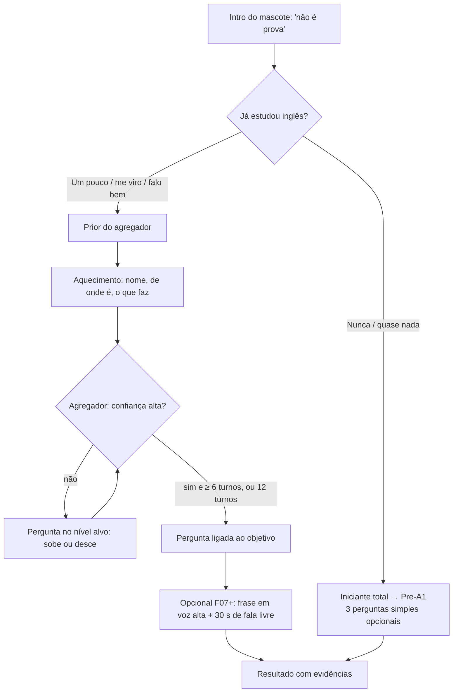

# Nivelamento — "a prova que não é prova"

## Princípios
1. **É um bate-papo**, não um teste: 5–10 minutos, tom acolhedor, sem nota de "reprovado".
2. **Só no idioma-alvo:** o mascote pede para responder em inglês; se a pessoa escrever em português, lembra com gentileza.
3. **Saída honrosa:** "Sou iniciante total" pula a conversa sem constrangimento.
4. **Adaptativo:** sobe ou desce a dificuldade conforme as respostas.
5. **Baseado em evidências:** cada julgamento cita frases reais do aluno.
6. **Quem decide é o código:** a IA estima turno a turno; um agregador determinístico calcula o nível (NIV-06).
7. **Privado:** a transcrição fica só no aparelho; o servidor guarda o resultado e citações curtas (NIV-09).
8. **Modo do professor não se aplica:** sempre neutro e gentil.

## Fluxo


## Banco de perguntas por faixa (curado — `content/languages/en/placement/questions.json`)
A IA escolhe e adapta perguntas deste banco (reduz improviso e alucinação).
| Faixa | Tipo de pergunta | Exemplos |
|---|---|---|
| A1 | Informações pessoais, rotina | *What's your name? Where are you from? What do you do every morning?* |
| A2 | Passado simples, planos, descrições | *What did you do last weekend? Describe your favorite place in your city.* |
| B1 | Experiências, opiniões simples, problemas | *Tell me about a problem you solved at work or school. Would you rather live in a big city or a small town? Why?* |
| B2 | Argumentação, hipóteses | *What would change in your life if you moved abroad? Some people say remote work is overrated — what do you think?* |
| C1 | Abstrato, nuance | *How has technology changed the way people build friendships? What's a belief you changed your mind about?* |
| C2 | Precisão, ironia, registro | *Explain a complex idea from your field to a child, then to an expert.* |

## Saída da IA por turno (`PlacementTurn`)
```ts
const PlacementTurn = z.object({
  reply: z.string().max(600),                        // próxima fala do mascote (inglês no nível-alvo)
  evaluation: z.object({
    grammar:     z.enum(LEVELS),                     // pre_a1 ... c2
    vocabulary:  z.enum(LEVELS),
    coherence:   z.enum(LEVELS),                     // fluência/coerência do texto
    interaction: z.enum(LEVELS),                     // responde ao que foi perguntado?
    confidence:  z.enum(['low','medium','high']),
    evidence: z.array(z.object({
      quote: z.string().max(200),                    // trecho LITERAL do aluno (verificado no código)
      observation: z.string().max(200),
      dimension: z.enum(['grammar','vocabulary','coherence','interaction']),
    })).max(4),
  }),
  learner_signals: z.object({ switched_language: z.boolean(), wants_to_stop: z.boolean() }),
});
```

## Algoritmo do agregador (código determinístico, testado)
Níveis indexados `k = 0..6` (Pre-A1 … C2).

1. **Prior** pela autoavaliação: "um pouco" → pico em A1; "me viro" → A2/B1; "falo bem" → B1/B2 (distribuição suave, nenhuma probabilidade zero).
2. **Estimativa do turno:** `b̄ₜ = 0,30·gramática + 0,30·vocabulário + 0,25·coerência + 0,15·interação`.
3. **Peso do turno:** `w = 0,5 / 1,0 / 1,5` para confiança baixa/média/alta; `w = 0,3` se a resposta tiver < 3 palavras; `w = 0` se respondeu em português ou se **nenhuma** citação passou na verificação literal.
4. **Verossimilhança:** `ℓₜ(k) = exp(−(k − b̄ₜ)² / (2σ²))`, com `σ = 0,8` (calibrar).
5. **Atualização:** `Pₜ(k) ∝ Pₜ₋₁(k) · ℓₜ(k)^w`, normalizada para somar 1.
6. **Próxima dificuldade:** se `max P > 0,5` → perguntar uma faixa **acima** do nível mais provável (sondar o teto); se o último `b̄ₜ` ficou mais de 1 abaixo da faixa perguntada → descer uma faixa.
7. **Parada:** (turnos ≥ 6 **e** `max P ≥ 0,70`) **ou** 12 turnos **ou** o aluno pediu para parar (resultado marcado "estimativa parcial").
8. **Nível final:** `k* = argmax P`. **Subnível:** média dos `b̄ₜ` dos turnos com peso > 0: abaixo de `k* − 0,33` → .1; entre ±0,33 → .2; acima de `k* + 0,33` → .3.
9. **Perfil por habilidade:** média ponderada de cada dimensão.
10. **Confiança exibida:** `P(k*)`.

Todos os parâmetros (`σ`, pesos, limiares) ficam em `app/src/config/placement.ts`, são testados com transcrições sintéticas (`../ia/avaliacoes-de-prompts-evals.md`, suíte `placement`) e **calibrados** na F05.

## Rubrica resumida (paráfrase dos descritores CEFR, usada no prompt do avaliador)
| Nível | Gramática | Vocabulário | Coerência | Interação |
|---|---|---|---|---|
| Pre-A1 | Palavras soltas | Muito poucas palavras | — | Responde com uma palavra/gesto |
| A1 | Frases simples memorizadas; erros frequentes | Básico do dia a dia | Frases isoladas, "and/but" | Responde perguntas diretas e lentas |
| A2 | Presente e passado simples com erros | Rotina, família, compras | Liga frases com conectivos simples | Troca curta e previsível |
| B1 | Tempos variados com controle razoável | Temas familiares; contorna lacunas | Texto conectado e linear | Sustenta conversa sobre temas conhecidos |
| B2 | Boa precisão; erros não atrapalham | Amplo, inclusive abstrato | Argumenta com clareza | Interage com fluência e espontaneidade |
| C1 | Alta precisão, estruturas complexas | Amplo e preciso, expressões idiomáticas | Organização sofisticada | Flexível, adapta registro |
| C2 | Controle consistente | Nuance e idiomaticidade quase nativas | Estilo e ênfase sob controle | Natural em qualquer contexto |

## Tela de resultado
- Nível + subnível (ex.: **A2.2 — Básico**) e confiança ("estimativa com 74% de confiança").
- **O que você já consegue fazer** (can-do em português).
- **Pontos fortes** com citações das próprias frases.
- **3 focos** para começar.
- Sugestão de meta diária.
- Aviso: "É uma estimativa para montar sua trilha — não um certificado."
- Botões: "Começar minha trilha" · "Refazer depois" (liberado após 7 dias ou a qualquer momento nas configurações).

## Casos especiais
| Caso | Tratamento |
|---|---|
| Responde em português | Lembrete gentil; turno com peso 0; após 3 vezes, oferece o caminho de iniciante |
| Respostas curtíssimas | Peso reduzido; mascote faz pergunta aberta |
| Texto que parece colado/traduzido | Lembrete: "responda do seu jeito, errar faz parte"; não bloqueamos colar (acessibilidade) |
| Conteúdo ofensivo ou fora do tema | Mascote redireciona com bom humor |
| Muito avançado | Perguntas C1/C2; teto em C2 |
| Parou no meio | Resultado parcial com aviso; pode continuar depois |

## Re-nivelamento
- Mensal (curto, 4–6 turnos, começando no nível atual) e na verificação de subida de nível.
- Muda o nível só se a confiança for ≥ 0,60 (calibrar); caso contrário, mantém e registra.
