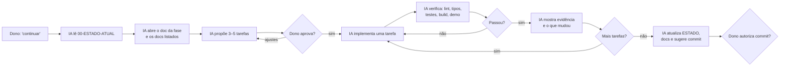

# Fluxo de trabalho — vibe coding guiado por fases

## Papéis
| Quem | Faz | Não faz |
|---|---|---|
| **Dono** | Decide, prioriza, aprova portões, testa no celular/PC, executa ações nas contas (criar projetos, chaves, pagar taxas), autoriza commits/push/deploys | Não precisa escrever código |
| **IA (Claude Code)** | Lê o estado, propõe planos, implementa, testa, documenta, prepara relatórios, explica em linguagem simples | Não avança fase sem aprovação, não executa ações externas sem autorização, não vê chaves/senhas |

## Ciclo de uma sessão


## Tamanho das tarefas
- Pequenas: cabem em uma sessão, mudam poucas centenas de linhas, têm verificação clara.
- Cada tarefa termina **verificável**: um teste, um comando com saída, uma tela para o dono ver.
- Tarefa grande → quebrar antes de começar (usar o modo de planejamento do Claude Code).

## Quando a IA deve parar e perguntar
1. A decisão muda uma ADR, o escopo da fase ou uma promessa de segurança/privacidade.
2. Precisa instalar dependência de runtime nova.
3. Precisa de ação externa (conta, pagamento, DNS, deploy, envio de e-mail).
4. Encontrou ambiguidade nos documentos ou conflito entre eles.
5. Um teste de segurança falhou e a correção não é óbvia.
6. Vai gastar créditos de API (evals, testes reais) — sempre com estimativa.

## Recursos do Claude Code que usamos
| Recurso | Uso no projeto |
|---|---|
| `CLAUDE.md` | Lido automaticamente; roteia para o estado e a fase |
| Modo de planejamento | Antes de tarefas grandes ou mudanças de arquitetura |
| `/code-review` | Em PRs relevantes e no portão |
| `/security-review` | Em todo portão e em PRs que tocam cofre, rede, auth, RLS, funções |
| Hooks | gitleaks no pré-commit; avaliação de hook que bloqueia gravação de padrões de chave (SEG-17) |
| Skill `claude-api` | Obrigatória antes de escrever código que chama o Claude |
| Subagentes | Só quando o dono pedir (ex.: revisão paralela) |
| MCP do Blender | Trilha de arte do mascote (F08), com aprovação por etapa |

## Gestão de contexto (sessões longas)
- A memória da conversa **não** é fonte de verdade; os documentos são.
- Conversa ficou longa ou mudou de assunto → a IA atualiza o `00-ESTADO-ATUAL.md` e sugere começar sessão nova.
- Ao retomar: "continuar" → protocolo de início (`CLAUDE.md`).

## Didática (o dono está aprendendo)
- Cada fase tem a seção "O que você vai aprender".
- Peça "explica como iniciante: <assunto>" a qualquer momento.
- A IA explica **por que** antes de **como** quando a decisão importa.
- Glossário: `../05-GLOSSARIO.md`.

## Modelos de pedido (copie e cole)
```text
continuar
```
```text
status — e me diga o que falta para o portão
```
```text
preparar portão
```
```text
aprovado F01
```
```text
aprovado com ressalvas F02: <ressalva 1>; <ressalva 2>
```
```text
reprovado: <o que não funcionou e como reproduzir>
```
```text
ideia: <descrição curta>
```
```text
mudar decisão: <ADR-XXXX> — <o que mudou e por quê>
```
```text
explica como iniciante: <assunto>
```
```text
revisão de segurança
```

## Idioma e comunicação
- Conversa e documentação em pt-BR; código, identificadores e commits em inglês.
- Respostas da IA: o que mudou, evidência, próximo passo — sem jargão desnecessário.
