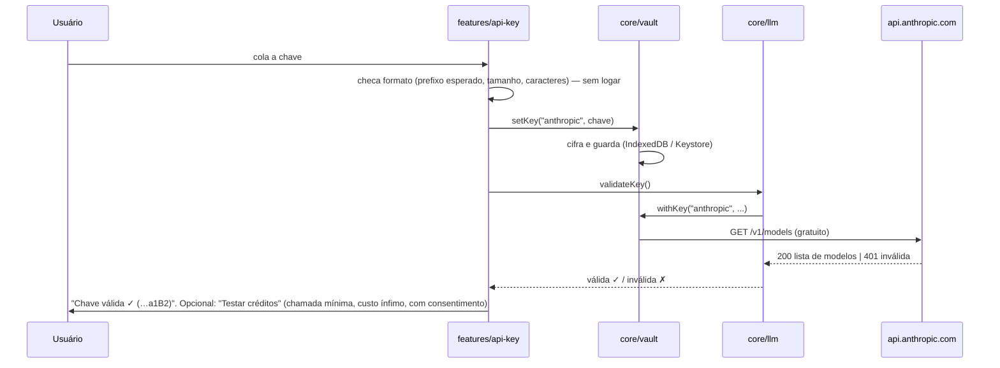

# Cofre da chave de API (BYOK) — especificação

> Este é o documento mais importante do projeto. A promessa central — **"sua chave fica só no seu aparelho"** — vive aqui, no código de `app/src/core/vault/` e nos testes que a comprovam.

## A promessa (texto que aparece no app, no site e no README)
> **Sua chave de API fica guardada só neste aparelho, cifrada. Ela é enviada somente para o provedor dela (ex.: `api.anthropic.com`), direto do seu aparelho. O PapeAI não tem servidores que recebam a sua chave — e o código aberto mostra isso.**

## O que o usuário precisa saber antes de colar a chave (tela educativa — BYOK-01/02)
1. **O que é:** uma senha que permite usar a IA e cobra o consumo na conta dele.
2. **Assinatura não é chave:** o plano do Claude (Pro/Max) não funciona como login aqui; é preciso uma chave da Claude Console. Alguns planos (Max, Ultra e Team, nas regras atuais) incluem créditos mensais de API — com link oficial: `https://platform.claude.com/docs/en/about-claude/api-credits-for-subscribers`.
3. **Como criar:** `https://platform.claude.com/settings/keys` → criar uma chave só para o PapeAI (ex.: "PapeAI – celular").
4. **Como se proteger:** definir **limite de gasto mensal** na Console; nunca compartilhar a chave; revogar se perder o aparelho.
5. **Quanto custa:** estimativa por lição e por mês em cada perfil de qualidade (`../ia/economia-de-tokens-e-custos.md`).
6. **Para onde vão as conversas:** direto do aparelho para a Anthropic, sob a conta do próprio usuário (PRIV-10).

## Requisitos cobertos
BYOK-01 a BYOK-16, SEG-16, PRIV-03, PRIV-10.

## Contrato do módulo
Definido em `../arquitetura/estrutura-de-pastas-e-modulos.md` (API pública do cofre). Pontos-chave:
- **Não existe `getKey()`**. A chave só existe dentro de `withKey(provider, fn)`.
- Cada provedor tem **domínio e caminhos fixos** no código (`config/providers.ts`): o cofre só entrega a chave da Anthropic para o cliente cujo `baseURL` é `https://api.anthropic.com`.
- `fingerprint()` devolve só os 4 últimos caracteres, para exibição.
- Todas as entradas são **por usuário e por aparelho** (`userId` + `provider`).

## Fluxo de cadastro da chave

- A listagem de modelos confirma que a chave é aceita **sem gastar tokens**. Só uma chamada de mensagem revela se há créditos — por isso o teste de créditos é opcional e explícito.
- Após colar: oferecer "limpar área de transferência" (a chave costuma ficar copiada).

## Implementação web (F03)
1. **Chave de cifra do aparelho:** na primeira vez, gerar `AES-GCM 256` com `crypto.subtle.generateKey(..., extractable = false, ['encrypt','decrypt'])` e guardar o objeto `CryptoKey` no banco IndexedDB **separado** `papeai-vault` (o navegador mantém a chave não exportável).
2. **Cifrar:** IV aleatório de 96 bits por gravação; guardar `{ userId, provider, iv, ciphertext, fingerprint, createdAt }`.
3. **PIN opcional (BYOK-09):** derivar chave com PBKDF2-SHA-256 (iterações altas — referência OWASP atual, confirmar na F03) + sal aleatório; a chave decifrada fica **só em memória** durante a sessão e é descartada ao bloquear/fechar; após 5 PINs errados, atraso crescente.
4. **Remover (BYOK-08):** apaga o registro e, se for a última chave, a `CryptoKey`; depois mostra como revogar na Console.
5. **Sem rastros:** o campo de entrada usa `type="password"` com botão mostrar/ocultar, `autocomplete="off"`, `spellcheck="false"`; nada de guardar em estado global persistido.

**Honestidade sobre a web:** cifrar no navegador protege contra leitura casual (DevTools, cópia de arquivos, programas que leem disco), mas **não** contra código malicioso rodando dentro do próprio app — esse código poderia pedir a decifragem. Contra isso, a defesa é impedir que ele rode: CSP estrita, zero scripts de terceiros e dependências mínimas e auditadas. O app nativo (F10) acrescenta o Keystore do sistema. Esse aviso aparece na tela "Como protegemos sua chave".

## Implementação nativa (F10)
| Item | Android | iOS (F12) |
|---|---|---|
| Armazenamento | Plugin de armazenamento seguro com Android Keystore (escolher e verificar na F10) | Keychain com acessibilidade `WhenUnlockedThisDeviceOnly` |
| Backup | Excluir dados do cofre do backup automático (`allowBackup`/regras de extração) | "ThisDeviceOnly" não vai para backup |
| Captura de tela | `FLAG_SECURE` na tela da chave | Ocultar conteúdo em capturas/multitarefa |
| Desbloqueio extra | Biometria opcional | Face ID/Touch ID opcional |

## Imposição de rede (BYOK-05)
1. **Guarda de rede (`core/net`):** todo `fetch` do app passa por ela. Allowlist de **domínio + caminho**:
   - `api.anthropic.com`: `/v1/messages`, `/v1/messages/count_tokens`, `/v1/models` (outros caminhos bloqueados — reduz canais de abuso).
   - `<projeto>.supabase.co`: Auth, REST, Functions.
   - Provedores de voz BYOK: só se o usuário ativar (F07).
   - Qualquer outro destino → bloqueado e registrado localmente (sem dados sensíveis).
2. **CSP `connect-src`** espelha a allowlist — o navegador recusa conexões fora dela mesmo se a guarda falhar.
3. **Cliente fixo:** `@anthropic-ai/sdk` com `baseURL` fixo em produção e `dangerouslyAllowBrowser: true` (necessário na web; envia o cabeçalho `anthropic-dangerous-direct-browser-access: true`, que habilita CORS). O nome "perigoso" alerta contra embutir a chave **do desenvolvedor** no site; no BYOK a chave é do próprio usuário, no aparelho dele — o padrão aceito.
4. **Supabase nunca recebe** a chave: o cliente Supabase não tem acesso ao cofre (regra de lint) e um teste E2E procura padrões de chave em todo tráfego que não vai à Anthropic.

## Logs e erros (BYOK-06)
- Proibido logar cabeçalhos de requisição, objetos de configuração do cliente ou o objeto de erro inteiro sem filtro.
- **Filtro global** (`core/usage/redact.ts`): substitui padrões de chave (`sk-ant-...` e padrões dos provedores de voz) por `[REDACTED]` em qualquer texto que vá para console, tela de erro ou relatório de feedback.
- Relatórios de erro (se existirem na F11) passam pelo mesmo filtro e por um teste.

## Testes que provam a promessa (BYOK-15)
| Teste | Tipo | O que verifica |
|---|---|---|
| `vault.never-plaintext` | Unitário | O valor guardado no IndexedDB nunca contém a chave em claro |
| `vault.no-getkey` | Unitário/tipo | A API pública não expõe leitura da chave |
| `vault.remove-wipes` | Unitário | Remover apaga de fato (registro e chave de cifra) |
| `vault.per-user` | Unitário | Usuário B no mesmo aparelho não acessa a chave do usuário A |
| `net.allowlist` | Unitário | Domínios/caminhos fora da lista são bloqueados |
| `e2e.key-only-to-anthropic` | E2E (Playwright) | Intercepta **todas** as requisições de uma sessão completa; a chave de teste só aparece em requisições para `api.anthropic.com` (cabeçalho `x-api-key`) e em nenhum outro lugar (URLs, corpos, cabeçalhos) |
| `e2e.csp-blocks` | E2E | Tentativa de `fetch` para domínio externo é bloqueada pela CSP |
| `log.redaction` | Unitário | Mensagens com padrões de chave saem mascaradas |
| `lint.vault-imports` | CI | Falha se algum módulo não autorizado importar `core/vault` |

Os testes usam uma **chave falsa** com formato válido e a API da Anthropic **simulada** (mock) — nenhum teste usa chave real.

## Transparência no código (BYOK-16)
- Cabeçalho de comentário em `core/vault/index.ts` e `core/net/index.ts` explicando a promessa e apontando para este documento.
- Tela "Como protegemos sua chave" no app, com link para os arquivos do código no GitHub.
- Seção no `SECURITY.md`.

## "Botão de pânico" e perda do aparelho
1. No app: Configurações → Chave → **Remover chave deste aparelho**.
2. Na Console: revogar a chave em `https://platform.claude.com/settings/keys` (o app mostra o link e o passo a passo).
3. Criar uma chave nova e colá-la no aparelho novo.

## Desenvolvimento (regras para o dono e para a IA)
- Usar uma **chave de desenvolvimento** separada, com limite de gasto baixo, numa organização/workspace só do PapeAI.
- **Nunca** colar chave real no chat da IA, em issues, commits ou arquivos versionados. Testes usam chave falsa.
- `.env.local` (se usado) fica fora do Git e **fora do OneDrive** (ver Q-12).
