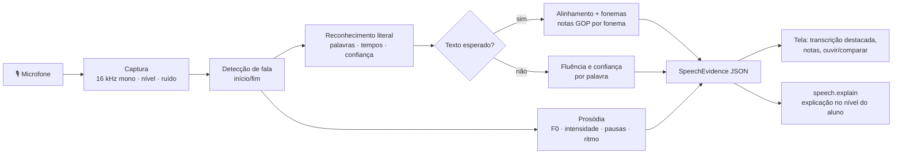

# Pipeline de fala — ouvir e falar com precisão

> **Fato que guia tudo:** a API de mensagens do Claude trabalha com texto, imagens e documentos — **não com áudio** (confirmar na F07 se isso mudou). O Claude é o "cérebro"; ouvidos e boca vêm de componentes de fala no aparelho (e, opcionalmente, de provedores com a chave do próprio usuário).

## Por que o reconhecimento comum "arredonda" o que você fala
Sistemas de reconhecimento de fala usam um **modelo de linguagem** que escolhe a sequência de palavras **mais provável** e costumam ser treinados para entregar texto "limpo" (sem hesitações, com erros corrigidos). Para um ditado isso é ótimo; para um aluno, é um desastre: o "fink" vira "think" e o erro some.

**Nossa abordagem:**
1. **Quando sabemos o texto esperado** (ler em voz alta, repetir o tutor, pares mínimos): comparamos **os sons (fonemas)** com o esperado, não as palavras. Assim, "fink" aparece como /f/ no lugar de /θ/.
2. **Na fala livre** (conversa): pedimos transcrição **literal** (com hesitações, repetições e falsos começos), guardamos a **confiança por palavra** e **nunca corrigimos a transcrição**. Palavra incerta é mostrada como incerta.
3. **Mostramos o que entendemos** (VOZ-08): a tela exibe exatamente o que o sistema reconheceu, com cores e níveis de confiança — o aluno vê se foi entendido.
4. **A IA de texto só explica medições** (TUT-12): recebe o `SpeechEvidence` e é proibida de comentar o que não foi medido.

## Visão geral


## Tipos de atividade de fala
| Tipo | Texto esperado? | O que medimos | Precisão possível |
|---|---|---|---|
| Ler em voz alta | Sim | Fonemas, palavras omitidas/inseridas, tonicidade, ritmo, entonação | Alta |
| Repetir o tutor (*shadowing*) | Sim | Tudo acima + comparação de entonação com a referência | Alta |
| Pares mínimos (*ship/sheep*) | Sim | O contraste específico | Alta |
| Responder pergunta curta | Parcial (respostas esperadas) | Palavras-chave, fonemas das palavras reconhecidas com confiança | Média |
| Conversa/roleplay livre | Não | Transcrição literal, confiança, fluência (pausas, velocidade, hesitações) | Média (pronúncia só onde a confiança é alta) |

## Contratos dos componentes (TypeScript — esboço para a F07)
```ts
interface SpeechCapture { start(): Promise<void>; stop(): Promise<AudioClip>; level$: Observable<number>; }
interface VoiceActivityDetector { segments(clip: AudioClip): Segment[]; }
interface SpeechRecognizer {        // sempre em modo literal
  transcribe(clip: AudioClip, lang: string): Promise<{
    words: { text: string; start: number; end: number; confidence: number }[];
    disfluencies: { kind: 'filler'|'repetition'|'false_start'; start: number; end: number; text: string }[];
  }>;
}
interface PronunciationAssessor {
  assess(clip: AudioClip, referenceText: string, variant: string): Promise<PhonemeAssessment>;
}
interface ProsodyAnalyzer { analyze(clip: AudioClip, words?: TimedWord[]): ProsodyMetrics; }
interface SpeechSynthesizer {
  speak(text: string, opts: { voice: string; rate: number }): Promise<{ audio: AudioClip; wordTimings?: TimedWord[] }>;
}
```
Cada interface tem implementações **locais** e (opcionais) **BYOK**; o resto do app não sabe qual está em uso.

## O tutor falando (TTS)
| Recurso | Comportamento | Requisito |
|---|---|---|
| Legendas | **Sempre** / **tocar para revelar** (modo desafio, vale XP extra) / **desligadas** | VOZ-02 |
| Destaque palavra a palavra | Usa tempos por palavra quando o motor fornece; senão, estimativa proporcional | VOZ-01 |
| Velocidade | 0,5× a 1,25× (padrão 1,0×) + botão "repetir mais devagar" (0,75×) | VOZ-03 |
| Vozes e sotaques | Lista por variante (en-US, en-GB, en-AU) conforme disponibilidade no aparelho/provedor | VOZ-04 |
| Boca do mascote | Eventos de palavra/viseme ou amplitude do áudio → animação (F08) | MAS-04 |

## O aluno falando — experiência
1. **Checagem do microfone** na primeira vez: medidor de nível, "diga *hello*", aviso de ruído alto.
2. **Apertar para falar** (padrão): toque para começar, toque para terminar; parada automática após ~1,5 s de silêncio; limite de 30–60 s.
3. Indicador visível de microfone ativo.
4. Resultado: transcrição literal com cores (verde = entendido com confiança; amarelo = incerto; vermelho = diferente do esperado), notas por palavra/fonema, botões **ouvir minha gravação** e **ouvir referência**.
5. Alternativa sem fala sempre disponível (VOZ-12).
6. Fones de ouvido recomendados no *shadowing* (evita o áudio do tutor vazar para o microfone).

## Privacidade (VOZ-09)
- Áudio processado no aparelho; fica em memória durante a atividade.
- Opcional: guardar as últimas 20 gravações por 7 dias para "ouvir de novo" (local).
- **Nunca** enviado ao servidor do PapeAI (teste E2E de rede).
- Provedor em nuvem só se o usuário ativar, com a chave dele e consentimento específico; a tela mostra para onde o áudio vai.

## Metas de desempenho (a medir na F07)
| Etapa | Meta |
|---|---|
| Primeiro som do TTS | < 1 s |
| Resultado de reconhecimento local (frase de ~5 s) | < 2–3 s em celular intermediário |
| Avaliação de pronúncia de frase curta | < 3 s |
| Download de modelos | Sob demanda, com tamanho informado, preferencialmente em Wi-Fi |

## Spike de benchmark (primeira tarefa da F07 — decide a ADR-0007)
1. **Conjunto de teste:** o dono grava 60–100 frases (corretas e com erros propositais típicos de brasileiros — `../pedagogia/metodologia.md`), com rótulos do que foi realmente dito; voluntários com consentimento, se possível.
2. **Candidatos:** reconhecimento no navegador (só como referência), modelos locais (via transformers.js/onnxruntime-web: modelos de transcrição e de reconhecimento de fonemas), e um provedor BYOK de avaliação de pronúncia.
3. **Métricas:** WER literal, detecção de erros de pronúncia (precisão/recall contra os rótulos), latência, tamanho do download, consumo de bateria, funcionamento em celular intermediário.
4. **Relatório** com tabela comparativa → dono decide → ADR-0007 "Aceita" com a escolha.
